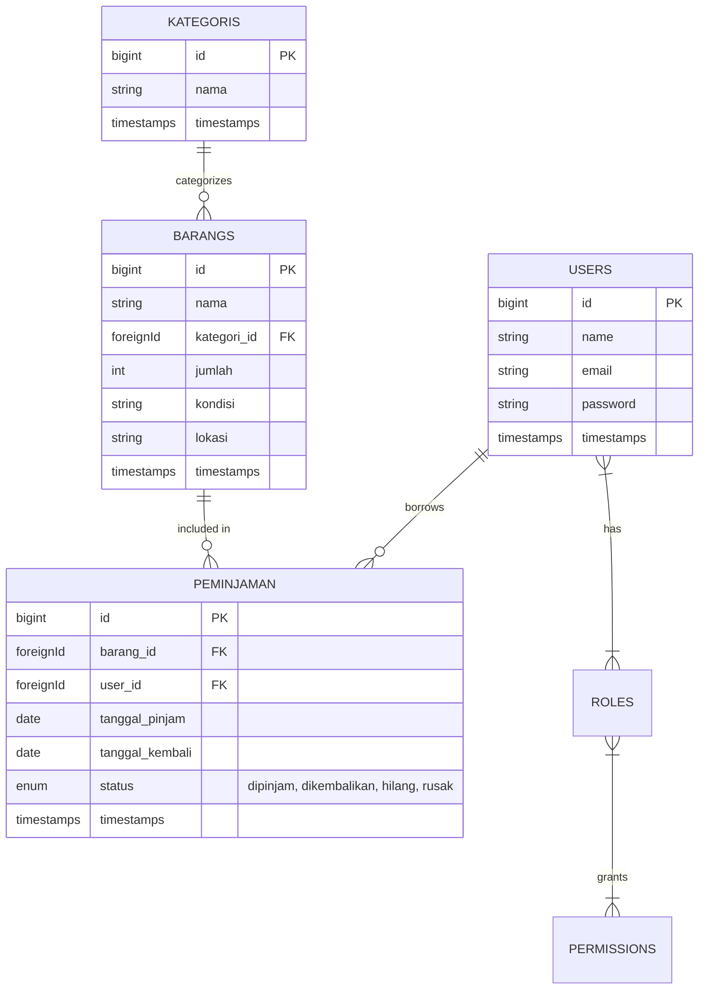

<div align="center">

# 📦 Inventory Management System

**A modern, robust, and full-featured asset tracking & loan management platform built with Laravel 11, Tailwind CSS, and DaisyUI.**

[](https://laravel.com)
[](https://php.net)
[](https://tailwindcss.com)
[](https://daisyui.com)
[](https://vitejs.dev)
[](LICENSE)

[Features](#-key-features) • [Tech Stack](#-technology-stack) • [Database Architecture](#-database-architecture) • [Role & Permissions](#-role--permission-matrix) • [Getting Started](#-getting-started) • [Default Credentials](#-default-seed-credentials) • [API Reference](#-api-endpoints)

</div>

---

## 📖 Overview

**Inventory Management System** is a web-based asset and loan tracking solution designed for schools, organizations, and enterprises. It streamlines equipment cataloging, tracks item conditions and locations, manages borrower transaction lifecycles, and enforces fine-grained access control using **Spatie Laravel-Permission**. In addition to an interactive web dashboard, it exposes powerful REST API endpoints via **Laravel Orion**.

---

## ✨ Key Features

- **📊 Interactive Dashboard**: High-level statistical overview showcasing total items, active categories, transaction counts, and registered users.
- **🏷️ Item Management (`Barang`)**: Complete CRUD capabilities for inventory items with attributes like stock quantity, item condition (e.g., Good, Damaged), and storage location.
- **📂 Category Classification (`Kategori`)**: Organize and group items dynamically into logical categories.
- **🔄 Loan & Return Tracking (`Peminjaman`)**:
  - Full checkout and checkin workflows.
  - Tracking borrower, loan date, and return date.
  - Multi-state tracking: `dipinjam` (borrowed), `dikembalikan` (returned), `rusak` (damaged), and `hilang` (lost).
- **🛡️ Role-Based Access Control (RBAC)**:
  - Powered by `spatie/laravel-permission`.
  - Dedicated role hierarchy: **Super Admin**, **Petugas (Staff)**, and **Siswa (Student/Member)**.
  - Route and action protection using middleware guards.
  - Safety protection preventing deletion of active self-assigned roles or default administrator accounts.
- **👥 User & Role Management**: Administrative interface to create, assign roles, and update credentials.
- **⚡ RESTful API (Laravel Orion)**: Pre-configured REST endpoints for seamless integration with mobile apps or external services, including automatic filtering, sorting, searching, and pagination.
- **🎨 Modern Dark UI**: Polished dark theme interface built with Tailwind CSS, DaisyUI drawer navigation, and Google Material Icons.

---

## 🛠 Technology Stack

### Backend
- **Framework:** [Laravel 11](https://laravel.com/)
- **Language:** PHP 8.2+
- **Database ORM:** Eloquent ORM (SQLite / MySQL compatible)
- **Authorization:** [Spatie Laravel-Permission](https://spatie.be/docs/laravel-permission)
- **API Engine:** [Laravel Orion](https://tailflow.github.io/laravel-orion-docs/)

### Frontend
- **Template Engine:** Laravel Blade
- **CSS Framework:** [Tailwind CSS 3](https://tailwindcss.com/)
- **UI Components:** [DaisyUI 5](https://daisyui.com/)
- **Build Tool:** [Vite 6](https://vitejs.dev/)
- **Typography & Icons:** Inter font & Material Icons

---

## 🗄️ Database Architecture



---

## 🔐 Role & Permission Matrix

| Module / Action | Super Admin | Petugas (Staff) | Siswa (Member) |
|---|:---:|:---:|:---:|
| **Dashboard** | ✅ View | ✅ View | ✅ View |
| **View Items (`Barang`)** | ✅ | ✅ | ✅ |
| **Create/Edit/Delete Items** | ✅ | ✅ | ❌ |
| **View Categories (`Kategori`)** | ✅ | ✅ | ✅ |
| **Create/Edit/Delete Categories** | ✅ | ✅ | ❌ |
| **View Loan Logs (`Peminjaman`)** | ✅ | ✅ | ✅ |
| **Create/Edit/Delete Loans** | ✅ | ✅ | ❌ |
| **View Users** | ✅ | ✅ | ❌ |
| **Manage Users (Create/Edit/Delete)** | ✅ | ❌ | ❌ |
| **Role & Permission Management** | ✅ | ❌ | ❌ |

---

## 🚀 Getting Started

Follow these steps to set up the project locally on your machine.

### Prerequisites

Ensure you have installed:
- **PHP** >= 8.2
- **Composer** (Latest)
- **Node.js** >= 18.x & **npm**
- **SQLite** or **MySQL**

---

### Step-by-Step Installation

#### 1. Clone the Repository
```bash
git clone https://github.com/Kendra271111/InventorySystem.git
cd InventorySystem
```

#### 2. Install PHP Dependencies
```bash
composer install
```

#### 3. Install NPM Dependencies
```bash
npm install
```

#### 4. Configure Environment
Duplicate the environment template file:
```bash
cp .env.example .env
```
*(On Windows PowerShell, use `copy .env.example .env`)*

Configure your database in `.env`. By default, SQLite is configured:
```env
DB_CONNECTION=sqlite
# Or configure MySQL:
# DB_CONNECTION=mysql
# DB_HOST=127.0.0.1
# DB_PORT=3306
# DB_DATABASE=inventory_system
# DB_USERNAME=root
# DB_PASSWORD=
```

If using SQLite, ensure the database file exists:
```bash
# Linux/macOS
touch database/database.sqlite

# Windows PowerShell
New-Item -ItemType File -Path database\database.sqlite -Force
```

#### 5. Generate Application Key
```bash
php artisan key:generate
```

#### 6. Run Migrations & Seed Default Data
This sets up the tables, roles, permissions, and creates default accounts:
```bash
php artisan migrate --seed
```

#### 7. Build Frontend Assets & Run Server
You can launch both the PHP web server and Vite dev server simultaneously:

```bash
# Option A: Run everything with Composer dev script (artisan serve, queue, logs, vite)
composer run dev

# Option B: Run standard artisan and vite in separate terminals
# Terminal 1:
php artisan serve

# Terminal 2:
npm run dev
```

Visit the application at: **[http://localhost:8000](http://localhost:8000)**

---

## 🔑 Default Seed Credentials

After running `php artisan migrate --seed`, you can log in using these pre-configured accounts:

| Role | Email | Password | Access Level |
|---|---|---|---|
| **Super Admin** | `Admin@gmail.com` | `admin` | Full System Access & Role Administration |
| **Petugas** | `Staff@gmail.com` | `staff` | Inventory & Loan Operations Access |
| **Siswa** | `Student@gmail.com` | `student` | Read-only Catalog & Loan History |

> [!NOTE]  
> Make sure to update these default credentials when deploying to a production or public environment!

---

## 🔌 API Endpoints

The system provides RESTful APIs powered by **Laravel Orion**. These endpoints support dynamic pagination, sorting, filtering, and search queries out of the box.

| Method | Endpoint | Description |
|---|---|---|
| `GET` | `/api/barang` | List inventory items (supports filtering & pagination) |
| `POST` | `/api/barang` | Create a new item |
| `GET` | `/api/barang/{id}` | Retrieve details for a specific item |
| `PATCH/PUT` | `/api/barang/{id}` | Update an existing item |
| `DELETE` | `/api/barang/{id}` | Delete an item |
| `GET` | `/api/user` | User endpoint (authenticated via Sanctum) |

#### Example: Querying the Item API with Orion
```bash
# Filter items by condition
curl -X POST http://localhost:8000/api/barang/search \
  -H "Content-Type: application/json" \
  -d '{
    "filters": [
      {"field": "kondisi", "operator": "=", "value": "Baik"}
    ]
  }'
```

---

## 📁 Directory Structure

```plaintext
InventorySystem/
├── app/
│   ├── Http/
│   │   ├── Controllers/
│   │   │   ├── Api/               # Orion REST API Controllers
│   │   │   ├── Auth/              # Authentication Controllers
│   │   │   ├── BarangController.php
│   │   │   ├── KategoriController.php
│   │   │   ├── PeminjamanController.php
│   │   │   ├── RoleController.php
│   │   │   └── UserController.php
│   │   └── Requests/              # Form Request Validation Rules
│   └── Models/
│       ├── Barang.php             # Item Eloquent Model
│       ├── Kategori.php           # Category Eloquent Model
│       ├── Peminjaman.php         # Loan Transaction Eloquent Model
│       └── User.php               # User Model with Spatie HasRoles
├── database/
│   ├── migrations/                # Database migrations & schemas
│   └── seeders/                   # Role, Permission, and User seeders
├── resources/
│   ├── css/                       # Tailwind CSS styling
│   ├── js/                        # JavaScript & Vite entrypoints
│   └── views/                     # Blade Templates (Dark Mode, DaisyUI)
│       ├── auth/                  # Login, Register, Password resets
│       ├── barang/                # Item CRUD views
│       ├── kategori/              # Category CRUD views
│       ├── layouts/               # Header, Footer, Sidebar, Drawer
│       ├── peminjaman/            # Loan CRUD views
│       └── user/                  # User Management views
├── routes/
│   ├── api.php                    # Orion API Routes
│   └── web.php                    # Web Application Routes
├── composer.json
├── package.json
├── tailwind.config.js
└── vite.config.js
```

---

## 🤝 Contributing

Contributions are welcome! If you would like to contribute:

1. **Fork** the repository
2. **Create** your feature branch (`git checkout -b feature/AmazingFeature`)
3. **Commit** your changes (`git commit -m 'Add some AmazingFeature'`)
4. **Push** to the branch (`git push origin feature/AmazingFeature`)
5. **Open** a Pull Request

---

## 📄 License

This project is open-sourced under the [MIT License](LICENSE).

---

<div align="center">
  <sub>Developed with ❤️ using Laravel & Tailwind CSS.</sub>
</div>
